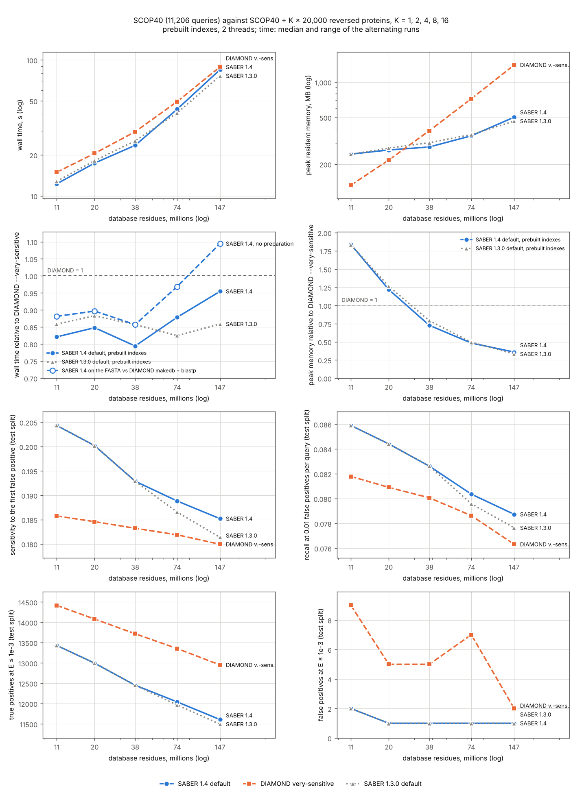
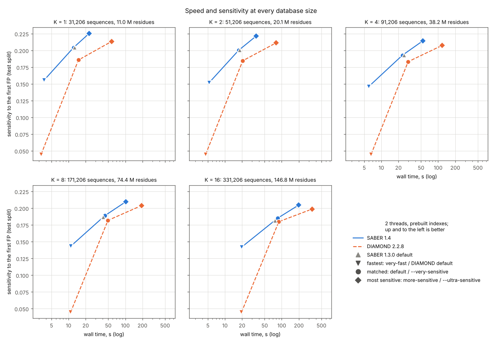
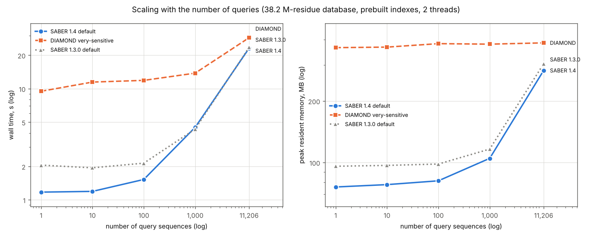
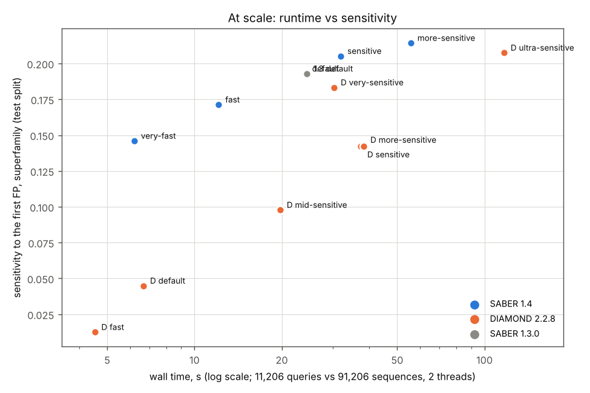
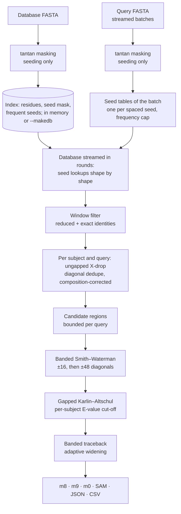

# 🗡️ SABER

### *Smith–Waterman homology search with BLAST-compatible output — seeded, bounded, calibrated.*

<div align="center">


</div>

---

# 🔬 What is SABER?

**SABER** is a protein and nucleotide homology search tool written in Rust.
It finds candidate regions with reduced-alphabet spaced seeds — for protein
searches by streaming the database past seed tables of a whole query batch —
scores them with affine-gap Smith–Waterman inside a diagonal band around
their seeded regions (AVX2), traces back the reported alignments with banded
dynamic programming that widens until it reproduces the band's exact score,
and reports gapped Karlin–Altschul E-values in BLAST formats.

* 🧬 **blastp** (`pp`) · 🧫 **blastn** (`nn`) · 🔄 **blastx** (`nx`) · 🔄 **tblastn** (`pn`)
* point it at a FASTA (index built in memory), or build a persistent,
  memory-mapped index once with `--makedb`
* `--preset exhaustive` runs full Smith–Waterman against every subject
  (reference mode); every other preset is a seed-and-extend heuristic, and the
  run summary says which limits were hit

### 📊 Measured performance (v1.4.0)

SABER 1.4.0 against DIAMOND 2.2.8 (every mode) and SABER 1.3.0, 2 threads,
one session (`bench/results/summary.md` has every run). The virtual machine
was replaced twice during the session, so three 2-vCPU machines of two CPU
types took part. **Machine A** (Intel Xeon @ 2.8 GHz, 33 MB L3) measured the
scaling and at-scale comparisons, the length-matched control, query-count
scaling and SCOP40 all-against-all. **Machine B** (Intel Xeon @ 2.1 GHz,
260 MB L3) ran the other sections and repeated the headline pairs. A third
machine of A's CPU type, slower than A, repeated the one-off search. Every
comparison below is within one machine.
*sens.* = fraction of a query's same-superfamily domains ranked above its
first false positive, averaged over the queries of the **held-out test
split** (tune split given where it matters); *recall* = fraction of all
same-superfamily pairs found before 0.01 false positives per query (pooled,
test split). Peak RSS in MB of 2^20 bytes.

**Scaling with database size** (machine A): the 11,206 SCOP40 domains
(SCOPe 2.08) against themselves plus K × 20,000 reversed proteins, K = 1, 2,
4, 8, 16. Every hit to a reversed protein or to another fold is a false
positive. Both tools search prebuilt indexes; SABER `default` and DIAMOND
`--very-sensitive` ran alternately, three times each (median):

| Database | SABER 1.4 `default` | DIAMOND `--very-sensitive` | time | memory | sens. test / tune | recall test / tune |
|---|---|---|---|---|---|---|
| 11.0 M residues | 12.3 s, 243 MB | 14.9 s, 132 MB | **0.82×** | 1.84× | **0.204** / **0.187** vs 0.186 / 0.175 | **0.086** / **0.049** vs 0.082 / 0.047 |
| 20.1 M | 17.4 s, 264 MB | 20.5 s, 217 MB | **0.85×** | 1.22× | **0.200** / **0.183** vs 0.185 / 0.174 | **0.084** / **0.048** vs 0.081 / 0.047 |
| 38.2 M | 23.5 s, 280 MB | 29.6 s, 385 MB | **0.79×** | **0.73×** | **0.193** / **0.177** vs 0.183 / 0.173 | **0.083** / **0.047** vs 0.080 / 0.046 |
| 74.4 M | 43.4 s, 349 MB | 49.4 s, 722 MB | **0.88×** | **0.48×** | **0.189** / **0.174** vs 0.182 / 0.172 | **0.080** / **0.046** vs 0.079 / 0.045 |
| 146.8 M | 84.9 s, 503 MB | 88.9 s, 1,400 MB | **0.95×** | **0.36×** | **0.185** / **0.171** vs 0.180 / 0.170 | **0.079** / **0.045** vs 0.076 / 0.044 |



- **Accuracy:** SABER is ahead on all four measures at every size. Its lead
  narrows with size: sensitivity +0.019 at 11 M residues, +0.005 at 147 M.
- **Homologues lost as the database grows:** some true homologues are found
  at 38 M residues and missed at 147 M, although their E-value scaled to the
  larger database would still be at most 10:
  - SABER 1.3.0: 839.
  - SABER 1.4: **23**. In 1.4 the region thresholds and the seed-frequency
    cap stop tightening above a 40 M-residue reference size.
  - DIAMOND `--very-sensitive`: 62.

  Below 40 M residues SABER's heuristics still tighten with the database:
  from 11 M to 147 M residues 1.4 loses 908 and DIAMOND 62
  (`docs/LIMITATIONS.md`).
- **Speed:** SABER is faster at every size. It takes 15–21 % less time up
  to 38 M residues, 12 % less at 74 M and 5 % less at 147 M. Above 38 M residues each additional
  million residues costs both tools about the same: 1.05–1.09 CPU seconds
  for SABER, 1.06–1.07 for DIAMOND. SABER's lead is therefore a nearly
  constant 4–6 s, and the ratio moves towards 1. Extrapolating the 74–147 M
  trend, DIAMOND would be faster beyond roughly 300 M residues (not
  measured).
- **Speed depends on the hardware:** on machine B the same pairs gave 0.95×
  at 38 M residues (26.0 vs 27.4 s) and 0.99× at 147 M (84.7 vs 85.7 s).
  Outputs were identical on both machines.
- **The price of the accuracy fix:** at 147 M residues 1.4 takes 11 % longer
  than 1.3.0 (84.9 vs 76.4 s) and uses 8 % more memory (503 vs 465 MB); it
  scores 2.6× as many candidate regions. At 74 M residues it takes 7 %
  longer (43.4 vs 40.8 s). Up to 40 M residues 1.4's output is
  byte-identical to 1.3.0's.
- **Memory:** much of SABER's memory is the seed tables of the 11,206-query
  batch, a fixed cost (about 160 MB by the estimate under 🧠 Memory), so it
  grows slowly with the database (243 → 503 MB);
  DIAMOND's grows with it (132 MB → 1.4 GB). On the two smaller databases
  SABER uses more memory; from 38 M residues on it uses less.
- **No preparation step** (SABER searching the FASTA, DIAMOND running
  `makedb` + `blastp`; one run each): SABER is faster up to 74 M residues
  (0.86–0.97×) and slower at 147 M (100.0 vs 91.4 s). Its index
  construction takes 4.4× as long as DIAMOND's `makedb` (17.7 vs 4.0 s at
  147 M): it masks the database and counts its seeds once, work DIAMOND
  repeats in every search.
- **The other tiers at 147 M residues:**
  - `very-fast` and DIAMOND default both take 19.6 s. `very-fast` has 3.2×
    the sensitivity (0.142 vs 0.045) and half the memory (261 vs 491 MB).
  - `more-sensitive` takes 199 s and 790 MB; `--ultra-sensitive` takes
    342 s and 3.1 GB. `more-sensitive` has the higher sensitivity on both
    splits and the higher test-split recall (0.084 vs 0.083), but a lower
    tune-split recall (0.0468 vs 0.0477).



**Length-matched control** (machine A): SABER's per-subject E-values make a
hit in a long subject less significant. The reversed proteins are longer
than the SCOP40 domains, so this could favour SABER. Here the same decoys
were cut to SCOP40 domain lengths (37.2 M residues). `default` still leads
`--very-sensitive` on the test split and on tune-split recall, and ties on
tune-split sensitivity (0.1733 vs 0.1733):

| | SABER `default` | DIAMOND `--very-sensitive` |
|---|---|---|
| Sens. test / tune | 0.189 / 0.173 | 0.183 / 0.173 |
| Recall test / tune | 0.082 / 0.046 | 0.080 / 0.046 |
| FDP at recall 0.08 | 0.0021 | 0.0037 |
| Time, peak RSS | 25.4 s, 293 MB | 32.1 s, 374 MB |

**Few queries** (machine A; against the prebuilt 38.2 M-residue index,
median of 3 runs). A single-query search takes about 40 % less time with
SABER 1.4 than with 1.3.0 and about 20 % less memory. At 1,000 queries 1.4
is slightly slower than 1.3.0 (4.5 vs 4.3 s):

| Queries | SABER 1.4 | SABER 1.3.0 | DIAMOND `--very-sensitive` |
|---|---|---|---|
| 1 | 1.2 s, 76 MB | 2.1 s, 96 MB | 9.5 s, 365 MB |
| 10 | 1.2 s | 1.9 s | 11.5 s |
| 100 | 1.5 s | 2.1 s | 11.9 s |
| 1,000 | 4.5 s | 4.3 s | 13.8 s |
| 11,206 | 23.1 s | 23.6 s | 28.8 s |



**At scale, every DIAMOND mode** (machine A): K = 4 above, 91,206 sequences
and 38.2 M residues. Each DIAMOND mode is shown next to the fastest SABER
heuristic preset (`exhaustive` aside) that is at least as sensitive by both
measures, on the test and on the tune split. A † marks pairs where no
heuristic preset is, on all four, and the closest one is shown (see the
note under the table):

| DIAMOND 2.2.8 | sens. | recall | time | peak RSS | SABER 1.4 | sens. | recall | time | peak RSS |
|---|---|---|---|---|---|---|---|---|---|
| `--fast` | 0.012 | 0.004 | 4.5 s | 143 MB | `very-fast` | 0.146 | 0.064 | 6.2 s | 111 MB |
| default | 0.045 | 0.015 | 6.7 s | 162 MB | `very-fast` | 0.146 | 0.064 | 6.2 s | 111 MB |
| `--mid-sensitive` | 0.098 | 0.039 | 19.7 s | 154 MB | `very-fast` | 0.146 | 0.064 | 6.2 s | 111 MB |
| `--sensitive` | 0.142 | 0.063 | 37.4 s | 163 MB | `very-fast` | 0.146 | 0.064 | 6.2 s | 111 MB |
| `--more-sensitive` | 0.142 | 0.063 | 38.4 s | 155 MB | `very-fast` | 0.146 | 0.064 | 6.2 s | 111 MB |
| **`--very-sensitive`** | 0.183 | 0.080 | 30.3 s | 385 MB | **`default`** | 0.193 | 0.083 | 24.2 s | 280 MB |
| `--ultra-sensitive` | 0.207 | 0.088 | 116.8 s | 903 MB | `more-sensitive` † | 0.214 | 0.090 | 55.7 s | 420 MB |

† `more-sensitive`'s pooled recall is higher on the test split (0.0898 vs 0.0882) but lower on the tune split (0.0495 vs 0.0501); its sensitivity is higher on both.

SABER 1.4 `default` against DIAMOND `--very-sensitive`, run alternately five
times each:
- **Time:** 20 % less (23.9–24.9 s vs 29.6–30.8 s; CPU 45.0 vs 58.3 s);
  with `-E 1e-3 -k 25`, 24.5 vs 30.6 s. On machine B: 26.0 vs 27.4 s.
- **Memory:** 27 % less (280 vs 385 MB; SABER 1.3.0: 304 MB).
- **Per-query ranking:** more true homologues are ranked above the first
  false positive on both splits (test 0.193 vs 0.183, tune 0.177 vs 0.173).
- **Pooled recall:** higher at 0.01 and at 0.1 false positives per query
  (0.0826 vs 0.0801, 0.0917 vs 0.0884).
- **False discoveries at matched recall:** a lower false-discovery
  proportion (0.0018 vs 0.0034 at recall 0.08, 0.022 vs 0.045 at 0.09).
  Only SABER reaches recall 0.10.
- **E ≤ 1e-3:** 1 false positive instead of 5. DIAMOND reports more true
  positives at that cut-off (13,720 vs 12,453); E-values are not comparable
  between tools.
- **Where the ranking gain comes from:** much of it comes from SABER's
  per-subject E-values, under which a score counts for less in a long
  subject. Ranked by database-wide E-values, as BLAST and DIAMOND rank hits
  (`--evalue-model database`), the same alignments give a sensitivity of
  0.187 (DIAMOND 0.183) but a pooled recall of 0.077 (DIAMOND 0.080).

Other results at scale:
- **`--algo 1`:** DIAMOND normally chooses its double-indexed seed search
  here. Forcing the query-indexed search with `--very-sensitive --algo 1`
  reaches `--ultra-sensitive`'s accuracy (0.208 / 0.088) in 59.9 s and
  430 MB on machine B, where `default` took 25.4 s.
- **Index construction:** SABER 3.6 s / 73 MB, DIAMOND 1.2 s / 59 MB.
- **No preparation step** (SABER searching the FASTA, DIAMOND `makedb` +
  `blastp`), on three virtual machines:
  - machine B, five alternating pairs: SABER 28.5 s / 310 MB, DIAMOND
    27.8 s / 385 MB. SABER was slower in all five pairs.
  - a third virtual machine of machine A's type, slower for both tools, five
    alternating runs each: SABER 1.4 39.8 s / 310 MB, SABER 1.3.0 39.7 s,
    DIAMOND 41.9 s / 388 MB. SABER 1.4 was faster in all five
    (`bench/results/checks_oneoff/`).
  - machine A, the scaling section's single runs: 27.5 vs 32.1 s.

  SABER's output equals the prebuilt-index output on every machine.
- **Other presets:** `fast` 0.171 / 12.1 s / 161 MB; `sensitive` 0.205 /
  32.0 s / 246 MB.
- **SABER 1.3.0:** the same output as 1.4, in 24.4 s / 304 MB.



**SCOP40 all-against-all** (machine A; 11,206 domains). SABER builds its
index in memory on every run; DIAMOND uses a prebuilt `.dmnd`:

| DIAMOND 2.2.8 | sens. | recall | time | peak RSS | SABER 1.4 | sens. | recall | time | peak RSS |
|---|---|---|---|---|---|---|---|---|---|
| `--fast` | 0.013 | 0.004 | 1.2 s | 27 MB | `very-fast` | 0.161 | 0.070 | 2.4 s | 59 MB |
| default | 0.045 | 0.016 | 1.9 s | 29 MB | `very-fast` | 0.161 | 0.070 | 2.4 s | 59 MB |
| `--mid-sensitive` | 0.099 | 0.040 | 5.2 s | 34 MB | `very-fast` | 0.161 | 0.070 | 2.4 s | 59 MB |
| `--sensitive` | 0.143 | 0.066 | 9.5 s | 38 MB | `very-fast` | 0.161 | 0.070 | 2.4 s | 59 MB |
| `--more-sensitive` | 0.143 | 0.066 | 9.7 s | 39 MB | `very-fast` | 0.161 | 0.070 | 2.4 s | 59 MB |
| **`--very-sensitive`** | 0.188 | 0.085 | 8.4 s | 58 MB | **`sensitive`** | 0.223 | 0.093 | 5.4 s | 88 MB |
| `--ultra-sensitive` | 0.218 | 0.096 | 29.5 s | 114 MB | `more-sensitive` † | 0.234 | 0.096 | 10.3 s | 163 MB |

† `more-sensitive`'s pooled recall is about 0.0001 lower (test 0.0958 vs
0.0959, tune 0.0551 vs 0.0552); its sensitivity is higher on both splits.
`exhaustive` (full Smith–Waterman) exceeds `--ultra-sensitive` on all four,
in 153.7 s and 35 MB.

On this small database SABER is slower than DIAMOND `--fast` and default,
at 13× and 3.6× their sensitivity, and faster in the other pairings. It
uses more memory in every pairing, because its seed tables have a fixed
part per seed shape.
- SABER 1.4 `default`: 0.210 / 0.088 / 6.1 s / 137 MB.
- SABER 1.3.0 `default`: the same output, 5.7 s. This section ran the two
  versions one after the other, not alternately.
- In a separate alternating A/B on machine B (five runs each), 1.4 took
  5.83 s and 1.3.0 5.96 s (`bench/results/checks/scop40_v13_v14_ab.jsonl`).

**MMseqs2 example workload** (machine B): 500 queries × 20,000 UniProt
sequences (9.1 M residues), E ≤ 1e-3. SABER builds its index in memory;
DIAMOND uses a prebuilt `.dmnd`. There are no labels:
- *Recall* is the fraction of the 16,344 query–subject pairs that SABER's
  exhaustive Smith–Waterman search reports at E ≤ 1e-3. That reference shares
  SABER's scoring and E-value statistics, so near the cut-off it favours SABER.
- The last column uses only its 12,600 pairs with E ≤ 1e-10, which any tool
  that finds them reports at E ≤ 1e-3.

| DIAMOND 2.2.8 | time | peak RSS | recall | E ≤ 1e-10 pairs | SABER 1.4 | time | peak RSS | recall | E ≤ 1e-10 pairs |
|---|---|---|---|---|---|---|---|---|---|
| `--fast` | 1.1 s | 46 MB | 0.264 | 0.337 | `very-fast` | 2.0 s | 63 MB | 0.891 | 0.958 |
| default | 1.5 s | 54 MB | 0.414 | 0.514 | `very-fast` | 2.0 s | 63 MB | 0.891 | 0.958 |
| `--mid-sensitive` | 4.0 s | 57 MB | 0.639 | 0.743 | `very-fast` | 2.0 s | 63 MB | 0.891 | 0.958 |
| `--sensitive` | 7.3 s | 63 MB | 0.766 | 0.869 | `very-fast` | 2.0 s | 63 MB | 0.891 | 0.958 |
| `--very-sensitive` | 5.1 s | 108 MB | 0.922 | 0.965 | `fast` | 2.6 s | 73 MB | 0.922 | 0.970 |
| `--ultra-sensitive` | 17.1 s | 118 MB | 0.942 | 0.968 | `sensitive` | 3.7 s | 69 MB | 0.956 | 0.983 |

Further results (machine B):
- **×4 database** (36 M residues, index built in memory and included):
  SABER `default` 11.9 s / 141 MB, DIAMOND `--very-sensitive` 16.3 s /
  372 MB. With prebuilt indexes: 8.9 vs 16.0 s warm, 9.3 vs 16.2 s cold.
- **99 long proteins** (> 1,500 residues): SABER `default` 5.1 s and 4,744
  alignments, DIAMOND `--very-sensitive` 5.9 s and 4,672.
- **SABER 1.3.0 `default`:** the same recall (0.949 / 0.981) in 4.1 s /
  96 MB; 1.4 took 4.0 s / 104 MB.
- **blastx:** `fast` 11.5 s, sensitivity 0.181 over all queries;
  `--very-sensitive` 12.7 s, 0.185; `default` 18.8 s, 0.199.
  `more-sensitive` 29.6 s, 0.219, against `--ultra-sensitive` 45.6 s, 0.213.
- **tblastn** (303 queries; DIAMOND has no tblastn mode): 2.1 s (1.3.0:
  2.4 s).

**Where DIAMOND is ahead** (each point within one machine):

- **The speed margin at large databases.** With prebuilt indexes SABER's
  lead shrinks to 5 % at 147 M residues on machine A and to 1 % on
  machine B. Each additional residue costs both tools about the same, so
  DIAMOND may well be faster on larger databases (an extrapolation from the
  74–147 M trend puts the crossover near 300 M residues on machine A).
- **One-off searches on large databases.** SABER's index construction takes
  4.4× as long as DIAMOND's `makedb` at 147 M residues (3× at scale), so a
  search with no preparation step is slower:
  - at 147 M residues: 100.0 vs 91.4 s (machine A);
  - at 38 M residues on machine B: 28.5 vs 27.8 s.

  At 38 M residues on the two other machines SABER was faster (by 5 % in
  alternating runs, by 14 % in a single run).
- **1.4 against 1.3.0 at large sizes.** The accuracy fix costs 11 % of
  SABER's own time at 147 M residues.
- **Speed at low sensitivity.** DIAMOND `--fast` is faster wherever it was
  run, at a fraction of the sensitivity:
  - at scale 4.5 s, against 6.2 s for `very-fast`, which has 12× its
    sensitivity;
  - on SCOP40 1.2 s against 2.4 s;
  - on the MMseqs2 example 1.1 s against 2.0 s.

  DIAMOND default is also faster than `very-fast` on SCOP40, on the
  MMseqs2 example and at 11 and 20 M residues. The two tie at 74 and 147 M
  residues (single runs), and `very-fast` is faster at 38 M.
- **Deepest tier at the lowest error rates.** `--ultra-sensitive` has a
  higher tune-split pooled recall than `more-sensitive` at every database
  size (0.0501 vs 0.0495 at scale, 0.0477 vs 0.0468 at 147 M residues) and
  a 0.0001 higher recall on SCOP40. On the length-matched control it also
  has the higher test-split sensitivity (0.2086 vs 0.2082).
- **True positives at a fixed E-value.** At E ≤ 1e-3 at scale,
  `--very-sensitive` reports 13,720 true and 5 false positives,
  `default` 12,453 and 1. At an equal number of false positives, SABER finds
  more (above).
- **Memory on small databases.** SABER's batch seed tables are a fixed cost:
  - at 11 M residues: 243 vs 132 MB;
  - at 20 M residues: 264 vs 217 MB;
  - in every SCOP40 pairing (e.g. `sensitive` 88 MB vs `--very-sensitive`
    58 MB);
  - at scale, `sensitive` takes 246 MB against `--sensitive`'s 163 MB.
- **blastx at `--very-sensitive`'s level.** DIAMOND takes 12.7 s / 101 MB
  for 0.185; the closest SABER preset, `fast`, takes 11.5 s for 0.181, and
  `default` 18.8 s / 147 MB for 0.199.
- **Two-domain queries.** DIAMOND finds more of each domain's homologues in
  absolute terms at E ≤ 1e-3 (`--very-sensitive` 212 / 1,749 against
  `default`'s 190 / 1,655, weaker / stronger domain). SABER keeps a larger
  fraction of each domain's single-domain hits (0.960 / 0.961 vs
  0.938 / 0.947).
- **Decoy hits at permissive cut-offs.** Against shuffled databases,
  `--very-sensitive` reports fewer false hits per query at E ≤ 1 and E ≤ 10
  (0.04 / 0.11, against `default`'s 0.06 / 0.72; both stay below E). At
  E ≤ 0.1 and below SABER reports fewer (0.004 vs 0.013 at E ≤ 0.1).
- **Thread scaling on SCOP40 all-against-all** (machine B): from 1 to 2
  threads SABER gains 1.64× (10.1 → 6.2 s) and DIAMOND 1.94× (15.9 →
  8.2 s). SABER builds its index in memory in this benchmark (included in
  its time).

Rerun `bench/scripts/run_all.sh` on your hardware before relying on these
numbers; `bench/README.md` describes the data, the protocol and the metrics.

---

# ✨ Features

<table>
<tr>
<td width="50%">

## 🧬 Alignment & statistics

* Gotoh affine-gap Smith–Waterman, exact 32-bit scores (8- and 16-bit SIMD with automatic exact repair of saturated lanes)
* Banded scoring around the seeded diagonals (two-stage, 8-bit inter-sequence AVX2) and banded traceback with adaptive widening — no alignment-length cap
* BLOSUM 45/50/62/80/90 · PAM 30/70/250 · nucleotide match/mismatch
* Gapped Karlin–Altschul parameters (NCBI tables) with BLAST length adjustment; per-subject (default) or database search space; unsupported scoring is rejected or explicitly marked uncalibrated
* Composition-bias score correction (Hauser et al. 2016)
* SAM-convention CIGAR, gap opens, positives, coverage of consumed residues

</td>
<td width="50%">

## 🚀 Speed & scale

* Scan schedule: seed tables of a query batch (huge pages), database streamed in rounds, AVX2 window filter and X-drop, bounded survivor memory
* Murphy-10 reduced-alphabet spaced seeds (DIAMOND's 16 very-sensitive shapes in `default`) + window filter on reduced and exact identities
* Persistent, memory-mapped index (CRC32-checked, atomic writes; seed postings optional)
* tantan low-complexity masking for seeding only; frequent-seed cap and region thresholds that stop tightening above a 40 M-residue reference database; diagonal deduplication
* Streaming query batches, ordered output; scan / query-major / intra-query / partition-major schedules with identical results
* `--stats` JSON: per-stage timers and cycle counts, work counters, heuristic limits hit

</td>
</tr>
</table>

---

# 🧱 Architecture



Every mode (pp, nn, nx, pn), the `--db` path and the library API run this one
engine. Protein searches use the scan schedule shown here; the query-major
schedule (each query looks its seeds up in an index with postings) gives the
same alignments and serves blastn, two-hit seeding and `--gpu`;
`--preset exhaustive` skips seeding and scores every subject.

---

# 🗡️ Tech Stack

| Component | Technology |
| --- | --- |
| Language | Rust ≥ 1.75 |
| Alignment kernels | Gotoh affine-gap Smith–Waterman and banded traceback (own code); i64 reference implementation for tests |
| SIMD | AVX2 intrinsics (scalar fallback elsewhere) |
| Parallelism | `rayon` |
| Persistent index | `memmap2` + `bytemuck` (zero-copy mmap), CRC32-checked sections |
| GPU (optional, experimental) | CUDA via `cudarc` / NVRTC |
| CLI | `clap` |
| Error handling | `anyhow` / `thiserror` |
| Serialization | `serde` (JSON output, `--stats`) |

---

# 🚀 Installation

```bash
# Rust 1.75 or newer
git clone https://github.com/raw-lab/saber
cd saber
cargo install --path .
```

Optional CUDA build (`cargo install --path . --features gpu-cuda`, CUDA toolkit
11+). **The GPU backend has not been run on GPU hardware** (1.2.0, unchanged in 1.3 and 1.4): its kernel
logic is tested on the CPU through an emulation harness
(`tools/gpu_emulate/`) and the host code type-checks when the CUDA headers are
installed, but treat `--gpu` as experimental and validate it with
`saber --doctor --gpu` (which compares GPU and CPU scores) on your machine.
Without a device SABER uses the CPU and says so.

---

# ⚡ Quick start

```bash
saber -q query.faa -d database.faa                    # blastp, default preset
saber -q query.faa -d database.faa --preset fast      # faster, less sensitive
saber -q query.faa -d database.faa --preset more-sensitive -E 1e-3 -k 25
saber -q reads.fna -d proteins.faa --mode nx          # blastx
saber -q query.faa -d genomes.fna  --mode pn          # tblastn
saber -q query.fna -d database.fna --mode nn          # blastn
```

Output is 12-column BLAST tabular (`m8`) by default. `examples/*.sh` are
runnable walkthroughs of every mode on the bundled example files (`make examples`).

## 🎯 Presets

| `--preset` | Seeds (Murphy-10 alphabet) | Window filter | Use |
|---|---|---|---|
| `very-fast` | the first 4 of DIAMOND's 16 weight-7 very-sensitive shapes | 28 | quick screening |
| `fast` | the first 8 of them | 27 | close and moderately distant homologs |
| `default` | all 16 (DIAMOND `--very-sensitive`'s seed set) | 27 | general use |
| `sensitive` | eight weight-6 shapes | 27 | remote homologs |
| `more-sensitive` | the 16 weight-7 and 8 weight-6 shapes | 27 | deepest heuristic search |
| `legacy` | full alphabet, contiguous 4-mers | off | SABER 1.x seeding (bounded, masked and composition-corrected) |
| `exhaustive` | none — every subject | – | reference / validation (slow) |

*Window filter*: a seed hit is extended only if the 32 residues around it
reach this value, counting reduced-alphabet identities once and exact
identities twice more. The heuristic presets score candidate regions inside
their diagonals ± 48 (first ± 16) and drop lone weak ungapped segments below
0.7 (`very-fast`, `fast`) or 0.65 × the query's reporting score floor at
`-E 10`; a more stringent `-E` or `--min-bitscore` only filters what an
`-E 10` search reports. On databases above 40 M residues these thresholds,
and the floor of the seed-frequency cap, are those of a 40 M-residue
database, so whether a homologue is found does not depend on how large the
rest of the database is. The presets were chosen
on the tune splits of the two SCOP40 benchmarks and evaluated on the held-out
test splits (`bench/README.md`). Individual flags (`--seed-alphabet`,
`--seed-shape`, `--hit-filter-ids`, `--hit-filter-exact-weight`,
`--score-band`, `--hsp-threshold`, `--index-max-candidates`, …) override
preset values.

## 💾 Persistent index

```bash
saber --makedb db.sdx -d db.fasta                  # residues, seed mask, frequent seeds
saber -q queries.faa --db db.sdx -E 1e-5           # memory-mapped, FASTA not needed
saber -q queries.faa --db db.sdx --verify-index    # full checksum pass first
saber --mode pn --makedb genomes.sdx -d genomes.fna  # translated index for tblastn
saber --makedb db.sdx -d db.fasta --index-postings # also seed postings (--batch-order query|partition)
```

The index is written partition by partition (bounded memory) to a temporary
file that is renamed into place only when complete; opening validates format
version, byte order, sizes, offsets and metadata checksums. It stores the
residues, the database seed mask and, per seed shape, the seeds that occur
more than 128 times (for the frequency cap) — about 1.2 bytes per residue
(42 MB for the 38.2 M-residue at-scale benchmark). Seed postings, needed only
by the query-major and partition-major schedules, are stored with
`--index-postings` (with the 16-shape `default` preset about 95 bytes per
residue: 3.2 GB instead of 41 MB for a 36 M-residue database). The default
scan schedule streams the whole database once per query batch, so a single
query costs a full pass: 1.2 s against the 38.2 M-residue at-scale index
(SABER 1.3.0: 2.1 s; DIAMOND `--very-sensitive`: 9.5 s). With postings,
`--batch-order query` answered a long single query in 0.5–0.6 s with the
same alignments (measured with 1.3). 1.2 and 1.3 indexes are
read by 1.4; **indexes from SABER ≤ 1.1 must be rebuilt** (see
`docs/MIGRATION.md`). Memory-mapped pages are managed by the OS page cache:
peak RSS of a `--db` search includes the pages actually touched, and mmap is
not a strict memory cap.

## 🧠 Memory

The scan schedule holds the seed tables of one query batch: about 4 bytes per
query residue and seed shape plus 2.5 MB per weight-7 shape (≈ 64 bytes per
residue + 40 MB for the 16-shape presets), in huge pages when the kernel
allows. Batches hold at most max(512 K, database residues / 4) query residues
(up to 8 M), so a small database is searched in several cheap passes with
small tables; `--memory-budget SIZE` (default: ¾ of RAM) lowers the batch
size further. Window-filter survivors are cut into pieces of about 2 M (16 MB)
by database chunk, subject and query. The database residues are read in place
from the index. Traceback direction matrices are capped at 32 MB per thread
(`--traceback-max-mb`). Measured peaks are in the tables above; on small
databases SABER 1.3 and 1.4 use more memory than 1.2 and DIAMOND
(`docs/LIMITATIONS.md`).

## 📈 Run summary

`--stats run.json` records timings (index build, search, per stage; for the
scan schedule CPU cycles per stage), peak RSS, counts of seed hits, hits
filtered, ungapped extensions and their X-drop steps, duplicate extensions
avoided, survivor cuts, candidate regions (and how many a cap dropped), DP
cells (SIMD / scalar / banded), regions rescored in the full band, saturation
repairs, band widenings, tracebacks restarted from the optimum's end cell or
capped, and the list of heuristic limits that applied to the run.

---

# 🧬 Search modes

| `--mode` | Alias | Query | Database | Notes |
|---|---|---|---|---|
| `pp` | `blastp` | protein | protein | |
| `nn` | `blastn` | nucleotide | nucleotide | default `--match 2 --mismatch -3`, gaps 7/2 (= BLAST 5/2) |
| `nx` | `blastx` | nucleotide | protein | six frames through the indexed engine; works with a protein `--db` |
| `pn` | `tblastn` | protein | nucleotide | translated index (six frames per sequence) |

Translated hits report nucleotide coordinates BLAST-style (minus strand:
start > end); the translated sequence's ID carries a `|frame±N` suffix and
JSON adds `query_frame`/`subject_frame`. E-values of translated searches use
the nucleotide database length / 3 as the search space.

Genetic codes: `--genetic-code` `standard` (1), `vertebrate` (2), `yeast` (3),
`mold` (4), `invertebrate` (5), `ciliate` (6), `echinoderm` (9), `bacterial`
(11), `archaeal` (= 11), `alt-yeast` (12), `blepharisma` (15).

---

# 📤 Output formats

| `--outfmt` | Description |
|---|---|
| `m8` | 12-column BLAST tabular (default) |
| `m9` | `m8` with comment header |
| `m0` | pairwise text alignment (marks UNCALIBRATED statistics) |
| `sam` | SAM records (SAM-convention CIGAR); the header has no `@SQ` lines, so give samtools the reference lengths (`samtools view -t ref.fai`) |
| `json` | streaming JSON array with frames, coverage, gap opens, calibration and exactness flags |
| `csv` | comma-separated |

m8 columns: `query subject pident length mismatch gapopen qstart qend sstart send evalue bitscore`.

---

# 📋 CLI reference (main options)

```
Input / index     -q/--query FILE   -d/--database FILE   --db INDEX   --makedb PATH
                  --verify-index    --mode pp|nn|nx|pn   --genetic-code CODE
Sensitivity       --preset NAME     --seed-alphabet full|murphy10|custom:GROUPS
                  --seed-shape 110111[,..]   --hit-filter-ids N   --hit-filter-exact-weight N
                  --hsp-threshold N  --x-drop N   --score-band N   --index-max-candidates N
                  --seed-max-occ N  --index-k K   --neighborhood-t T   --index-min-hits 2
                  --two-hit-window W   --masking tantan|none   --exhaustive (= --no-index)
Scoring           -m/--matrix M     -g/--gap-open N  -e/--gap-extend N  --gap-convention saber|blast
                  --match N --mismatch N     --comp-bias on|off   --allow-uncalibrated-evalues
Reporting         -E/--evalue X     --evalue-model per-subject|database   --min-bitscore X
                  -k/--max-aligns N   --max-hsps N
                  --percent-identity X  --query-cover X  --subject-cover X
                  --min-length N --max-length N   -o/--output FILE   --outfmt FMT
Resources         -t/--threads N|auto   --memory-budget SIZE   --tmpdir DIR   --index-postings
                  --query-batch N   --batch-order auto|scan|query|partition   --band N   --gpu
Diagnostics       --stats FILE   --doctor   -v/--verbose   --quiet
```

Gap penalties: by default (`--gap-convention saber`, as in SABER 1.x) a gap of
length *k* costs `-g + (k−1)·-e`; with `--gap-convention blast` it costs
`-g + k·-e` (so BLAST/DIAMOND `11/1` = SABER `12/1`; SABER's default 11/1 =
BLAST 10/1). `saber --help` lists every option, including the 1.x options that
are still accepted (see `docs/MIGRATION.md`).

---

# 🩺 Self-check

```bash
saber --doctor                       # build, CPU features, matrices, statistics,
                                     # SIMD vs reference, seeded vs exhaustive search,
                                     # index round-trip, GPU parity (if present)
saber --doctor --db db.sdx -q q.faa  # also validate your files
```

---

# 🧪 Testing and benchmarks

```bash
cargo test --release           # 131 unit + 24 integration + 1 doc test (reference SW, identical
                               # results across schedules, bounded processing, pathological
                               # inputs, index corruption)
bench/scripts/run_all.sh       # reproducible benchmark suite (see bench/README.md)
```

`IMPLEMENTATION_CHECKLIST.md` records every change with its evidence;
`docs/MIGRATION.md` lists behaviour changes since 1.3, 1.2 and 1.1; known
limitations and untested paths are in `docs/LIMITATIONS.md`.

---

# 📄 License

**Creative Commons Attribution-NonCommercial (CC BY-NC 4.0)** — see `LICENSE`.

# 📖 Citation

- White III RA & Figueroa III JL. 2026. SABER: GPU-accelerated Smith-Waterman homology search with BLAST-like output. bioRxiv.
- Please also cite SWORD: Vaser R, Pavlović D, Šikić M. SWORD—a highly efficient protein database search. *Bioinformatics* 32(17):i680–i684 (2016).

SABER 1.4 uses methods from: Frith 2011 (tantan), Hauser et al. 2016 and
Yu & Altschul 2005 (composition bias), Murphy et al. 2000 (reduced alphabet),
Altschul et al. 1997 / NCBI BLAST (statistics and length adjustment),
Buchfink et al. 2015/2021 (DIAMOND: reduced-alphabet spaced seeds — the
`default` preset uses DIAMOND's very-sensitive seed shapes — and window
identity filter), Pearson (FASTA/SSEARCH) and Eddy (HMMER) for per-subject
E-values.

# 📞 Support

* 🐛 Issues: https://github.com/raw-lab/saber/issues
* 📧 Dr. Richard Allen White III — rwhit101@charlotte.edu
