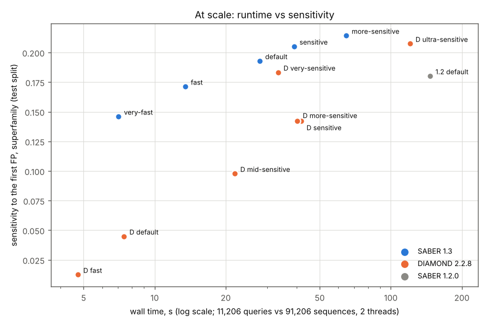
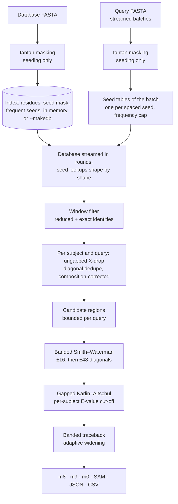

# 🗡️ SABER

### *Smith–Waterman homology search with BLAST-compatible output — seeded, bounded, calibrated.*

<div align="center">


</div>

---

# 🔬 What is SABER?

**SABER** is a protein and nucleotide homology search tool written in Rust.
It finds candidate regions with reduced-alphabet spaced seeds — for protein
searches by streaming the database past seed tables of a whole query batch —
scores them with affine-gap Smith–Waterman inside a diagonal band around
their seeded regions (AVX2), traces back the reported alignments with banded
dynamic programming that widens until it reproduces the band's exact score,
and reports gapped Karlin–Altschul E-values in BLAST formats.

* 🧬 **blastp** (`pp`) · 🧫 **blastn** (`nn`) · 🔄 **blastx** (`nx`) · 🔄 **tblastn** (`pn`)
* point it at a FASTA (index built in memory), or build a persistent,
  memory-mapped index once with `--makedb`
* `--preset exhaustive` runs full Smith–Waterman against every subject
  (reference mode); every other preset is a seed-and-extend heuristic, and the
  run summary says which limits were hit

### 📊 Measured performance (v1.3.0)

All numbers: one 2-vCPU virtual machine (Intel Xeon @ 2.80 GHz), 2 threads,
one session, SABER 1.3.0 against DIAMOND 2.2.8 (every mode) and SABER 1.2.0;
`bench/results/summary.md` has every run. *sens.* = fraction of a query's
same-superfamily domains ranked above its first false positive, averaged over
the queries of the **held-out test split**; *recall* = fraction of all
same-superfamily pairs found before 0.01 false positives per query (pooled,
test split). Each DIAMOND mode is shown next to the fastest SABER preset that
is at least as sensitive by both measures, on the test and on the tune split;
† = no preset is, on all four, and the closest is shown (noted below the
table). Peak RSS in MB of 2^20 bytes.

**At scale**: the 11,206 SCOP40 domains (SCOPe 2.08) searched against
themselves plus 80,000 reversed proteins (91,206 sequences, 38.2 M residues).
Every hit to a reversed protein or to another fold counts as a false positive.
Both tools search prebuilt indexes:

| DIAMOND 2.2.8 | sens. | recall | time | peak RSS | SABER 1.3 | sens. | recall | time | peak RSS |
|---|---|---|---|---|---|---|---|---|---|
| `--fast` | 0.012 | 0.004 | 4.7 s | 144 MB | `very-fast` | 0.146 | 0.064 | 7.0 s | 129 MB |
| default | 0.045 | 0.015 | 7.4 s | 147 MB | `very-fast` | 0.146 | 0.064 | 7.0 s | 129 MB |
| `--mid-sensitive` | 0.098 | 0.039 | 21.9 s | 155 MB | `very-fast` | 0.146 | 0.064 | 7.0 s | 129 MB |
| `--sensitive` | 0.142 | 0.063 | 41.7 s | 161 MB | `very-fast` | 0.146 | 0.064 | 7.0 s | 129 MB |
| `--more-sensitive` | 0.142 | 0.063 | 40.2 s | 156 MB | `very-fast` | 0.146 | 0.064 | 7.0 s | 129 MB |
| **`--very-sensitive`** | 0.183 | 0.080 | 33.3 s | 386 MB | **`default`** | 0.193 | 0.083 | 27.9 s | 303 MB |
| `--ultra-sensitive` | 0.207 | 0.088 | 120.7 s | 907 MB | `more-sensitive` † | 0.214 | 0.090 | 64.8 s | 449 MB |

† `more-sensitive`'s pooled recall is higher on the test split (0.0898 vs 0.0882) but lower on the tune split (0.0495 vs 0.0501); its sensitivity is higher on both.

SABER 1.3 `default` against DIAMOND `--very-sensitive`, run alternately five
times each:
- **Time:** 16 % faster (27.5–28.2 s vs 32.5–34.3 s; CPU 51.3 vs 63.9 s).
  With `-E 1e-3 -k 25`: 26.3 vs 32.9 s.
- **Memory:** 21 % less (303 vs 386 MB).
- **Per-query ranking:** more true homologues ranked above the first false
  positive on both splits (test 0.193 vs 0.183, tune 0.177 vs 0.173).
- **Pooled recall:** higher at 0.01 and at 0.1 false positives per query
  (0.0826 vs 0.0801, 0.0917 vs 0.0884).
- **False discoveries at matched recall:** a lower false-discovery proportion
  (0.0018 vs 0.0034 at recall 0.08, 0.022 vs 0.045 at 0.09). Recall 0.10 is
  reached only by SABER.
- **E ≤ 1e-3:** 1 false positive instead of 5. DIAMOND reports more true
  positives at that cut-off (13,720 vs 12,453); E-values are not comparable
  between tools.
- **Where the ranking gain comes from:** largely from SABER's per-subject
  E-values (a score counts for less in a long subject). Ranked by
  database-wide E-values, as BLAST and DIAMOND rank hits
  (`--evalue-model database`), the same alignments give a per-query
  sensitivity of 0.187 (DIAMOND 0.183) but a pooled recall of 0.077 (DIAMOND
  0.080).

DIAMOND's query-indexed seed search, forced with `--very-sensitive
--algo 1` (DIAMOND normally picks its double-indexed search here), reaches
`--ultra-sensitive`'s accuracy (0.208 / 0.088) in 72.4 s and 434 MB.
`more-sensitive` is faster (64.8 s) and more sensitive (0.214 / 0.090), but
its tune-split recall is slightly lower (0.0495 vs 0.0499) and it uses
449 MB.

**No preparation step**: SABER can search the FASTA database directly,
building its index in memory, and that time is included. Five alternating
runs at scale:
- SABER `default`: 32.7 s (31.0–34.2 s), 308 MB.
- DIAMOND `makedb` + `blastp --very-sensitive`: 33.8 s (33.4–35.4 s), 386 MB.

SABER was faster in all five pairs, but by only 3 % at the median
(0.91–0.97×). Index construction alone takes 4.0 s for SABER and 1.2 s for
DIAMOND: SABER's index already holds the database's low-complexity mask and
seed frequencies, which DIAMOND computes during every search.

Other presets at scale:
- `fast`: 0.171 / 13.5 s / 180 MB.
- `sensitive`: 0.205 / 39.0 s / 269 MB.

SABER 1.2.0 took 146.6 s on this benchmark (sens. 0.180).



**SCOP40 all-against-all** (11,206 domains). SABER builds its index in memory
on every run; DIAMOND uses a prebuilt `.dmnd`:

| DIAMOND 2.2.8 | sens. | recall | time | peak RSS | SABER 1.3 | sens. | recall | time | peak RSS |
|---|---|---|---|---|---|---|---|---|---|
| `--fast` | 0.013 | 0.004 | 1.6 s | 29 MB | `very-fast` | 0.161 | 0.070 | 2.7 s | 58 MB |
| default | 0.045 | 0.016 | 2.3 s | 32 MB | `very-fast` | 0.161 | 0.070 | 2.7 s | 58 MB |
| `--mid-sensitive` | 0.099 | 0.040 | 6.6 s | 31 MB | `very-fast` | 0.161 | 0.070 | 2.7 s | 58 MB |
| `--sensitive` | 0.143 | 0.066 | 11.1 s | 46 MB | `very-fast` | 0.161 | 0.070 | 2.7 s | 58 MB |
| `--more-sensitive` | 0.143 | 0.066 | 11.5 s | 49 MB | `very-fast` | 0.161 | 0.070 | 2.7 s | 58 MB |
| **`--very-sensitive`** | 0.188 | 0.085 | 9.3 s | 59 MB | **`sensitive`** | 0.223 | 0.093 | 7.0 s | 83 MB |
| `--ultra-sensitive` | 0.218 | 0.096 | 33.5 s | 117 MB | `more-sensitive` † | 0.234 | 0.096 | 12.3 s | 161 MB |

† `more-sensitive`'s pooled recall is 0.0958 vs 0.0959 (tune 0.0551 vs
0.0552): equal within 0.0001, not higher; its sensitivity is higher on both
splits.

On this small database SABER is slower than DIAMOND `--fast` and default
(at 4–12× their sensitivity) and faster in the other pairings, but uses more
memory in every pairing, because its seed tables have a fixed part per seed
shape. SABER 1.3 `default`: 0.211 / 0.088 / 7.1 s / 137 MB;
SABER 1.2.0 `default`: 0.197 / 0.080 / 8.0 s / 29 MB.

**MMseqs2 example workload**: 500 queries × 20,000 UniProt sequences
(9.1 M residues), E ≤ 1e-3. SABER builds its index in memory; DIAMOND uses a
prebuilt `.dmnd`. There are no labels:
- *Recall* is the fraction of the 16,344 query–subject pairs that SABER's
  exhaustive Smith–Waterman search reports at E ≤ 1e-3. That reference shares
  SABER's scoring and E-value statistics, so near the cut-off it favours SABER.
- The last column uses only its 12,600 pairs with E ≤ 1e-10, which any tool
  that finds them reports at E ≤ 1e-3.

| DIAMOND 2.2.8 | time | peak RSS | recall | E ≤ 1e-10 pairs | SABER 1.3 | time | peak RSS | recall | E ≤ 1e-10 pairs |
|---|---|---|---|---|---|---|---|---|---|
| `--fast` | 1.2 s | 48 MB | 0.264 | 0.337 | `very-fast` | 2.2 s | 62 MB | 0.891 | 0.958 |
| default | 1.7 s | 47 MB | 0.414 | 0.514 | `very-fast` | 2.2 s | 62 MB | 0.891 | 0.958 |
| `--mid-sensitive` | 4.6 s | 55 MB | 0.639 | 0.743 | `very-fast` | 2.2 s | 62 MB | 0.891 | 0.958 |
| `--sensitive` | 8.5 s | 63 MB | 0.766 | 0.869 | `very-fast` | 2.2 s | 62 MB | 0.891 | 0.958 |
| `--very-sensitive` | 6.1 s | 108 MB | 0.922 | 0.965 | `fast` | 2.9 s | 69 MB | 0.922 | 0.970 |
| `--ultra-sensitive` | 19.5 s | 119 MB | 0.942 | 0.968 | `sensitive` | 4.3 s | 73 MB | 0.956 | 0.983 |

Further MMseqs2 results:
- **×4 database** (36 M residues, index built in memory and included): SABER
  `default` 13.6 s / 135 MB, DIAMOND `--very-sensitive` 18.7 s / 365 MB.
- **99 long proteins** (> 1,500 residues): SABER `default` 5.6 s and 4,744
  alignments, DIAMOND `--very-sensitive` 6.1 s and 4,672.
- SABER 1.2.0 `default`: 6.3 s / 106 MB, recall 0.947 / 0.980 (1.3
  `default`: 4.6 s / 96 MB, 0.949 / 0.981).
- **Single queries** (three long proteins, each searched alone against the
  prebuilt ×4 index): 1.9–2.4 s each, DIAMOND `--very-sensitive` 11.1–11.9 s,
  SABER 1.2.0 0.1 s — its index stores seed postings, while 1.3 streams the
  whole database for every query batch (`docs/LIMITATIONS.md`).

**Where DIAMOND is ahead** (same machine, same session):

- **Speed at low sensitivity.** DIAMOND `--fast` takes 4.7 s at scale,
  SABER's fastest preset (`very-fast`) 7.0 s, with 12× its sensitivity
  (0.146 vs 0.012). On the smaller benchmarks DIAMOND `--fast` and default
  are also faster than `very-fast` (SCOP40 1.6 / 2.3 s vs 2.7 s; MMseqs2
  example 1.2 / 1.7 s vs 2.2 s), at a fraction of its sensitivity.
- **Deepest tier at the lowest error rates.** Below 0.1 false positives per
  query, `--ultra-sensitive` mostly has the higher pooled recall on SCOP40
  (test split; e.g. 0.0884 vs 0.0847 at 0.002, equal within 0.0001 at 0.01);
  at scale it does below 0.05 on the tune split and below 0.002 on the test
  split. Above those rates `more-sensitive` has the higher recall.
- **True positives at a fixed E-value.** At E ≤ 1e-3 at scale,
  `--very-sensitive` reports 13,720 true and 5 false positives on the test
  split, `default` 12,453 and 1. E-values are not comparable between tools;
  at an equal number of false positives SABER finds more (above).
- **Index construction.** `makedb` at scale: 1.2 s / 59 MB vs 4.0 s /
  73 MB. DIAMOND masks the database and counts its seeds in every search
  instead (1.1 s + 3.3 s per search by its own log).
- **Memory on small databases.** SABER uses more memory in every SCOP40
  pairing (e.g. `sensitive` 83 MB vs `--very-sensitive` 59 MB) and on the
  MMseqs2 example's 25 % and 50 % subsets (`default` 84 / 89 MB vs
  `--very-sensitive` 44 / 73 MB). At scale, `sensitive` takes 269 MB
  (`--sensitive` 161 MB).
- **blastx.** `--very-sensitive` takes 14.8 s / 107 MB (sensitivity 0.185
  over all queries); the fastest SABER preset at least as sensitive,
  `default`, 20.3 s / 141 MB (0.199; `fast`, 12.9 s, reaches 0.181). In the
  deepest tier SABER is ahead (`more-sensitive` 32.5 s, 0.219 vs
  `--ultra-sensitive` 53.1 s, 0.213).
- **Two-domain queries.** DIAMOND finds more of each domain's homologues in
  absolute terms at E ≤ 1e-3 (`--very-sensitive` 212 / 1,749 vs `default`
  190 / 1,655, weaker / stronger domain); SABER keeps a larger fraction of
  each domain's single-domain hits (0.960 / 0.961 vs 0.938 / 0.947).
- **Decoy hits at permissive cut-offs.** Against shuffled databases,
  `--very-sensitive` reports fewer false hits per query at E ≤ 1 and E ≤ 10
  (0.04 / 0.11 vs `default` 0.06 / 0.72; both stay below E). At E ≤ 0.1 and
  below SABER reports fewer (0.004 vs 0.013 at E ≤ 0.1).

Rerun `bench/scripts/run_all.sh` on your hardware before relying on these
numbers; `bench/README.md` describes the data, the protocol and the metrics.

---

# ✨ Features

<table>
<tr>
<td width="50%">

## 🧬 Alignment & statistics

* Gotoh affine-gap Smith–Waterman, exact 32-bit scores (8- and 16-bit SIMD with automatic exact repair of saturated lanes)
* Banded scoring around the seeded diagonals (two-stage, 8-bit inter-sequence AVX2) and banded traceback with adaptive widening — no alignment-length cap
* BLOSUM 45/50/62/80/90 · PAM 30/70/250 · nucleotide match/mismatch
* Gapped Karlin–Altschul parameters (NCBI tables) with BLAST length adjustment; per-subject (default) or database search space; unsupported scoring is rejected or explicitly marked uncalibrated
* Composition-bias score correction (Hauser et al. 2016)
* SAM-convention CIGAR, gap opens, positives, coverage of consumed residues

</td>
<td width="50%">

## 🚀 Speed & scale

* Scan schedule: seed tables of a query batch (huge pages), database streamed in rounds, AVX2 window filter and X-drop, bounded survivor memory
* Murphy-10 reduced-alphabet spaced seeds (DIAMOND's 16 very-sensitive shapes in `default`) + window filter on reduced and exact identities
* Persistent, memory-mapped index (CRC32-checked, atomic writes; seed postings optional)
* tantan low-complexity masking for seeding only; frequent-seed cap; diagonal deduplication
* Streaming query batches, ordered output; scan / query-major / intra-query / partition-major schedules with identical results
* `--stats` JSON: per-stage timers and cycle counts, work counters, heuristic limits hit

</td>
</tr>
</table>

---

# 🧱 Architecture



Every mode (pp, nn, nx, pn), the `--db` path and the library API run this one
engine. Protein searches use the scan schedule shown here; the query-major
schedule (each query looks its seeds up in an index with postings) gives the
same alignments and serves blastn, two-hit seeding and `--gpu`;
`--preset exhaustive` skips seeding and scores every subject.

---

# 🗡️ Tech Stack

| Component | Technology |
| --- | --- |
| Language | Rust ≥ 1.75 |
| Alignment kernels | Gotoh affine-gap Smith–Waterman and banded traceback (own code); i64 reference implementation for tests |
| SIMD | AVX2 intrinsics (scalar fallback elsewhere) |
| Parallelism | `rayon` |
| Persistent index | `memmap2` + `bytemuck` (zero-copy mmap), CRC32-checked sections |
| GPU (optional, experimental) | CUDA via `cudarc` / NVRTC |
| CLI | `clap` |
| Error handling | `anyhow` / `thiserror` |
| Serialization | `serde` (JSON output, `--stats`) |

---

# 🚀 Installation

```bash
# Rust 1.75 or newer
git clone https://github.com/raw-lab/saber
cd saber
cargo install --path .
```

Optional CUDA build (`cargo install --path . --features gpu-cuda`, CUDA toolkit
11+). **The GPU backend has not been run on GPU hardware** (1.2.0, unchanged in 1.3.0): its kernel
logic is tested on the CPU through an emulation harness
(`tools/gpu_emulate/`) and the host code type-checks when the CUDA headers are
installed, but treat `--gpu` as experimental and validate it with
`saber --doctor --gpu` (which compares GPU and CPU scores) on your machine.
Without a device SABER uses the CPU and says so.

---

# ⚡ Quick start

```bash
saber -q query.faa -d database.faa                    # blastp, default preset
saber -q query.faa -d database.faa --preset fast      # faster, less sensitive
saber -q query.faa -d database.faa --preset more-sensitive -E 1e-3 -k 25
saber -q reads.fna -d proteins.faa --mode nx          # blastx
saber -q query.faa -d genomes.fna  --mode pn          # tblastn
saber -q query.fna -d database.fna --mode nn          # blastn
```

Output is 12-column BLAST tabular (`m8`) by default. `examples/*.sh` are
runnable walkthroughs of every mode on the bundled example files (`make examples`).

## 🎯 Presets

| `--preset` | Seeds (Murphy-10 alphabet) | Window filter | Use |
|---|---|---|---|
| `very-fast` | the first 4 of DIAMOND's 16 weight-7 very-sensitive shapes | 28 | quick screening |
| `fast` | the first 8 of them | 27 | close and moderately distant homologs |
| `default` | all 16 (DIAMOND `--very-sensitive`'s seed set) | 27 | general use |
| `sensitive` | eight weight-6 shapes | 27 | remote homologs |
| `more-sensitive` | the 16 weight-7 and 8 weight-6 shapes | 27 | deepest heuristic search |
| `legacy` | full alphabet, contiguous 4-mers | off | SABER 1.x seeding (bounded, masked and composition-corrected) |
| `exhaustive` | none — every subject | – | reference / validation (slow) |

*Window filter*: a seed hit is extended only if the 32 residues around it
reach this value, counting reduced-alphabet identities once and exact
identities twice more. The heuristic presets score candidate regions inside
their diagonals ± 48 (first ± 16) and drop lone weak ungapped segments below
0.7 (`very-fast`, `fast`) or 0.65 × the query's reporting score floor at
`-E 10`; a more stringent `-E` or `--min-bitscore` only filters what an
`-E 10` search reports. The presets were chosen
on the tune splits of the two SCOP40 benchmarks and evaluated on the held-out
test splits (`bench/README.md`). Individual flags (`--seed-alphabet`,
`--seed-shape`, `--hit-filter-ids`, `--hit-filter-exact-weight`,
`--score-band`, `--hsp-threshold`, `--index-max-candidates`, …) override
preset values.

## 💾 Persistent index

```bash
saber --makedb db.sdx -d db.fasta                  # residues, seed mask, frequent seeds
saber -q queries.faa --db db.sdx -E 1e-5           # memory-mapped, FASTA not needed
saber -q queries.faa --db db.sdx --verify-index    # full checksum pass first
saber --mode pn --makedb genomes.sdx -d genomes.fna  # translated index for tblastn
saber --makedb db.sdx -d db.fasta --index-postings # also seed postings (--batch-order query|partition)
```

The index is written partition by partition (bounded memory) to a temporary
file that is renamed into place only when complete; opening validates format
version, byte order, sizes, offsets and metadata checksums. It stores the
residues, the database seed mask and, per seed shape, the seeds that occur
more than 128 times (for the frequency cap) — about 1.2 bytes per residue
(44 MB for the 38.2 M-residue at-scale benchmark). Seed postings, needed only
by the query-major and partition-major schedules, are stored with
`--index-postings` (with the 16-shape `default` preset about 95 bytes per
residue: 3.4 GB instead of 43 MB for a 36 M-residue database). The default
scan schedule streams the whole database once per query batch, so a single
query costs a full pass (about 2 s against those 36 M residues); with
postings, `--batch-order query` answers it in about 0.5 s with the same
alignments. 1.2 indexes are
read by 1.3; **indexes from SABER ≤ 1.1 must be rebuilt** (see
`docs/MIGRATION.md`). Memory-mapped pages are managed by the OS page cache:
peak RSS of a `--db` search includes the pages actually touched, and mmap is
not a strict memory cap.

## 🧠 Memory

The scan schedule holds the seed tables of one query batch: about 4 bytes per
query residue and seed shape plus 2.5 MB per weight-7 shape (≈ 64 bytes per
residue + 40 MB for the 16-shape presets), in huge pages when the kernel
allows. Batches hold at most max(512 K, database residues / 4) query residues
(up to 8 M), so a small database is searched in several cheap passes with
small tables; `--memory-budget SIZE` (default: ¾ of RAM) lowers the batch
size further. Window-filter survivors are cut into pieces of about 2 M (16 MB)
by database chunk, subject and query. The database residues are read in place
from the index. Traceback direction matrices are capped at 32 MB per thread
(`--traceback-max-mb`). Measured peaks are in the tables above; on small
databases SABER 1.3 uses more memory than 1.2 and DIAMOND
(`docs/LIMITATIONS.md`).

## 📈 Run summary

`--stats run.json` records timings (index build, search, per stage; for the
scan schedule CPU cycles per stage), peak RSS, counts of seed hits, hits
filtered, ungapped extensions and their X-drop steps, duplicate extensions
avoided, survivor cuts, candidate regions (and how many a cap dropped), DP
cells (SIMD / scalar / banded), regions rescored in the full band, saturation
repairs, band widenings, tracebacks restarted from the optimum's end cell or
capped, and the list of heuristic limits that applied to the run.

---

# 🧬 Search modes

| `--mode` | Alias | Query | Database | Notes |
|---|---|---|---|---|
| `pp` | `blastp` | protein | protein | |
| `nn` | `blastn` | nucleotide | nucleotide | default `--match 2 --mismatch -3`, gaps 7/2 (= BLAST 5/2) |
| `nx` | `blastx` | nucleotide | protein | six frames through the indexed engine; works with a protein `--db` |
| `pn` | `tblastn` | protein | nucleotide | translated index (six frames per sequence) |

Translated hits report nucleotide coordinates BLAST-style (minus strand:
start > end); the translated sequence's ID carries a `|frame±N` suffix and
JSON adds `query_frame`/`subject_frame`. E-values of translated searches use
the nucleotide database length / 3 as the search space.

Genetic codes: `--genetic-code` `standard` (1), `vertebrate` (2), `yeast` (3),
`mold` (4), `invertebrate` (5), `ciliate` (6), `echinoderm` (9), `bacterial`
(11), `archaeal` (= 11), `alt-yeast` (12), `blepharisma` (15).

---

# 📤 Output formats

| `--outfmt` | Description |
|---|---|
| `m8` | 12-column BLAST tabular (default) |
| `m9` | `m8` with comment header |
| `m0` | pairwise text alignment (marks UNCALIBRATED statistics) |
| `sam` | SAM records (SAM-convention CIGAR); the header has no `@SQ` lines, so give samtools the reference lengths (`samtools view -t ref.fai`) |
| `json` | streaming JSON array with frames, coverage, gap opens, calibration and exactness flags |
| `csv` | comma-separated |

m8 columns: `query subject pident length mismatch gapopen qstart qend sstart send evalue bitscore`.

---

# 📋 CLI reference (main options)

```
Input / index     -q/--query FILE   -d/--database FILE   --db INDEX   --makedb PATH
                  --verify-index    --mode pp|nn|nx|pn   --genetic-code CODE
Sensitivity       --preset NAME     --seed-alphabet full|murphy10|custom:GROUPS
                  --seed-shape 110111[,..]   --hit-filter-ids N   --hit-filter-exact-weight N
                  --hsp-threshold N  --x-drop N   --score-band N   --index-max-candidates N
                  --seed-max-occ N  --index-k K   --neighborhood-t T   --index-min-hits 2
                  --two-hit-window W   --masking tantan|none   --exhaustive (= --no-index)
Scoring           -m/--matrix M     -g/--gap-open N  -e/--gap-extend N  --gap-convention saber|blast
                  --match N --mismatch N     --comp-bias on|off   --allow-uncalibrated-evalues
Reporting         -E/--evalue X     --evalue-model per-subject|database   --min-bitscore X
                  -k/--max-aligns N   --max-hsps N
                  --percent-identity X  --query-cover X  --subject-cover X
                  --min-length N --max-length N   -o/--output FILE   --outfmt FMT
Resources         -t/--threads N|auto   --memory-budget SIZE   --tmpdir DIR   --index-postings
                  --query-batch N   --batch-order auto|scan|query|partition   --band N   --gpu
Diagnostics       --stats FILE   --doctor   -v/--verbose   --quiet
```

Gap penalties: by default (`--gap-convention saber`, as in SABER 1.x) a gap of
length *k* costs `-g + (k−1)·-e`; with `--gap-convention blast` it costs
`-g + k·-e` (so BLAST/DIAMOND `11/1` = SABER `12/1`; SABER's default 11/1 =
BLAST 10/1). `saber --help` lists every option, including the 1.x options that
are still accepted (see `docs/MIGRATION.md`).

---

# 🩺 Self-check

```bash
saber --doctor                       # build, CPU features, matrices, statistics,
                                     # SIMD vs reference, seeded vs exhaustive search,
                                     # index round-trip, GPU parity (if present)
saber --doctor --db db.sdx -q q.faa  # also validate your files
```

---

# 🧪 Testing and benchmarks

```bash
cargo test --release           # 128 unit + 23 integration + 1 doc test (reference SW, identical
                               # results across schedules, bounded processing, pathological
                               # inputs, index corruption)
bench/scripts/run_all.sh       # reproducible benchmark suite (see bench/README.md)
```

`IMPLEMENTATION_CHECKLIST.md` records every change with its evidence;
`docs/MIGRATION.md` lists behaviour changes since 1.2 and 1.1; known
limitations and untested paths are in `docs/LIMITATIONS.md`.

---

# 📄 License

**Creative Commons Attribution-NonCommercial (CC BY-NC 4.0)** — see `LICENSE`.

# 📖 Citation

- White III RA & Figueroa III JL. 2026. SABER: GPU-accelerated Smith-Waterman homology search with BLAST-like output. bioRxiv.
- Please also cite SWORD: Vaser R, Pavlović D, Šikić M. SWORD—a highly efficient protein database search. *Bioinformatics* 32(17):i680–i684 (2016).

SABER 1.3 uses methods from: Frith 2011 (tantan), Hauser et al. 2016 and
Yu & Altschul 2005 (composition bias), Murphy et al. 2000 (reduced alphabet),
Altschul et al. 1997 / NCBI BLAST (statistics and length adjustment),
Buchfink et al. 2015/2021 (DIAMOND: reduced-alphabet spaced seeds — the
`default` preset uses DIAMOND's very-sensitive seed shapes — and window
identity filter), Pearson (FASTA/SSEARCH) and Eddy (HMMER) for per-subject
E-values.

# 📞 Support

* 🐛 Issues: https://github.com/raw-lab/saber/issues
* 📧 Dr. Richard Allen White III — rwhit101@charlotte.edu
